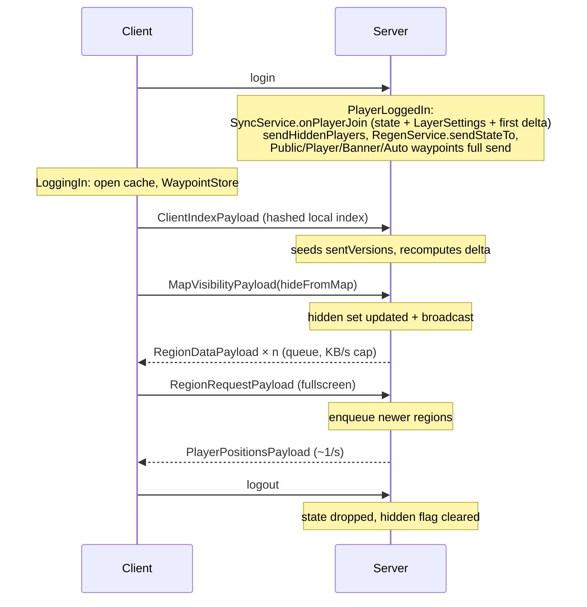

# 03 — Synchronization protocol

Server → client map synchronization, plus the small C2S/S2C payloads that surround it.
Implementation: `SyncService` (server), `ClientMapCache` / `DiskCache` / `ClientNetHandler`
(client), payload records in `common.network`.

## 1. Session lifecycle

| ID | Requirement |
|----|-------------|
| SYNC-01 | On join the server creates a `PlayerState` (`sentVersions`, queue, in-flight region), sends `LayerSettingsPayload`, then queues a first delta **immediately** — before the handshake can have arrived, so with an empty `sentVersions`. Keys already queued are not removed when the handshake later seeds `sentVersions` (see [11](11-limitations-and-open-issues.md), L-04). |
| SYNC-02 | On dimension change the server resends `LayerSettingsPayload`. |
| SYNC-03 | On logout the player state is removed and the player is removed from the hidden set (the preference is re-sent on reconnect). |
| SYNC-04 | The client on login: clears RAM state, opens the disk cache, opens the waypoint store, uploads the hashed index, fires the JourneyMap `MAPPING_STARTED` event for bridged plugins, sends its `hideFromMap` preference. On logout it fires `MAPPING_STOPPED` first, then flushes and closes the stores. |

## 2. Handshake

| ID | Requirement |
|----|-------------|
| HS-01 | The client sends one entry per indexed region as a text line `indexKey=version:sha256` (GZIP-compressed): `dim|LAYER|band|rx|rz=<version>:<sha256 lowercase hex>`. |
| HS-02 | The SHA-256 is **recomputed by the client from the cached file** off-thread (never read from the index, which a tampering user could edit along with the file). Entries whose file is missing or unreadable are omitted (declared "not owned"). |
| HS-03 | The server decodes at most **50 000** entries; malformed lines are skipped. |
| HS-04 | For each entry the server calls `isTampered(key, version, sha)`: tampered ⇔ the server recorded a hash for exactly that `(key, version)` **and** it differs (case-insensitive) from the client's. Tampered entries are not seeded (so the delta re-pushes the authoritative bytes) and counted in a warning log. |
| HS-05 | Any other combination (no recorded hash, empty client hash, other version) falls back to version comparison. The public (quarantine) variant has no recorded hash and is compared by version only. |
| HS-06 | Non-tampered entries seed `sentVersions[key] = clientVersion`; the server then immediately recomputes the delta for that player. |

## 3. Delta push

| ID | Requirement |
|----|-------------|
| DEL-01 | For each player the server periodically (`sync.syncRateTicks`, default 40 = 2 s) queues every region within `sync.pushRadiusRegions` (default 2, i.e. a 5×5 region window) of the player's region, for every active layer of the player's dimension (all configured cave bands for `cave`) plus the INFO sidecar. |
| DEL-02 | A region is queued iff `serverVersion(key, trusted) > sentVersions[key]` (or `-1`), and `serverVersion ≥ 0`. `trusted` comes from the quarantine service ([04](04-privacy-and-anti-exploit.md)). |
| DEL-03 | The periodic trigger is phase-shifted per player: it fires when `gameTime % syncRateTicks == (entityId & 15)`. |
| DEL-04 | A just-rendered batch of regions is queued immediately for every player in the same dimension (`pushRegionUpdates`, hopping to the main thread), without waiting for the periodic delta and regardless of the push radius. |
| DEL-05 | A player's queue is a `ConcurrentLinkedQueue` with a companion set so a key is queued at most once. |

## 4. Batching and fragmentation

| ID | Requirement |
|----|-------------|
| BAT-01 | Each tick the server drains a player's queue within a byte budget: `maxKbPerSecondPerPlayer × 1024 / 20` (default 512 KB/s ≈ 26 214 B/tick). |
| BAT-02 | One region is transferred at a time per player. Bytes are sliced into fragments of `common.fragmentSize` bytes (default 28 000; range 8 000–900 000). The loop stops once the budget is `≤ 0`, so a tick may exceed it by up to one fragment. |
| BAT-03 | At send time the server re-evaluates `trusted`, re-reads `dataOf(key, trusted)` and `versionOf(key, trusted)`; a key whose data is gone is skipped. A mismatch with the queueing-time decision self-corrects on the next delta. |
| BAT-04 | When the last fragment is sent, `sentVersions[key] = version`, `regionsSent++`, `bytesSent += len`. |
| BAT-05 | Payload: `RegionDataPayload(key, version, part, totalParts, bytes)`; for image layers the bytes are the PNG, for INFO the GZIP hover blob. |

## 5. Client assembly

| ID | Requirement |
|----|-------------|
| ASM-01 | A fragment is ignored when the client already holds `version ≥ received` for that key (newest of its resident textures and the cache index) **and** either some texture of the region is resident or the key is an INFO sidecar. A region that is only on disk is therefore accepted again, which repairs a missing or corrupt cache file the handshake declared as not owned. |
| ASM-02 | Fragments of one `(key, version)` are collected in a `PENDING` assembly; a newer version replaces an older pending assembly; out-of-range or duplicate parts are ignored. |
| ASM-03 | When complete: the region is stored to the disk cache and its textures are brought up to date (ASM-06); every texture is a `DynamicTexture` with wrap mode `CLAMP_TO_EDGE` on S and T to avoid one-pixel seams at region borders. INFO blobs are only stored to disk and their parsed copy invalidated. |
| ASM-04 | On upload the client computes a per-chunk **content mask** (bit `localZ*32 + localX` = chunk has ≥ 1 non-transparent pixel), used to veil only painted chunks during a regen. |
| ASM-05 | `ClientMapCache.getOrLoad(key, level)` lazily and **asynchronously** loads a region from the disk cache on first display: the file read and PNG decode (plus the downscale for a reduced level, [07 §3.5](07-client-ui.md)) run on two worker threads, and `pumpLoads()` (called once per frame by the minimap and the fullscreen map) uploads the decoded textures on the render thread, within a per-frame budget of 4 × 512² texels (four full images) and 32 uploads. At most **8** loads are in flight; `getOrLoad` returns null, or a resident texture of the same region at another level, until the wanted one completes, and callers retry next frame. A result is dropped if the texture was evicted/cleared meanwhile or a newer version is being decoded. One attempt per key; misses are remembered until a new version arrives. Hover sidecars are parsed lazily into a bounded LRU of **8** regions. |
| ASM-06 | With the disk cache on, a completed region is persisted first, then only the levels of detail already resident or loading are re-decoded on a loader thread, from the bytes in hand (never re-read from disk, so the pending write cannot be raced); the old texture is replaced when the new one is uploaded. A region with no resident texture produces none: it loads from disk when first drawn. With the disk cache off the region is decoded and uploaded as level 0 on the render thread at once (it cannot be reloaded). |

## 6. On-demand requests (fullscreen map)

| ID | Requirement |
|----|-------------|
| REQ-01 | The fullscreen map requests, per frame, the regions covering the viewport that are missing/stale — plus the INFO sidecar of each — in one `RegionRequestPayload(keys, knownVersions)` of **≤ 64 keys**. |
| REQ-02 | Client anti-spam: a key is requested at most once every **5 s** (`LAST_REQUESTED`). |
| REQ-03 | Server: ignored entirely when `sync.allowOnDemandRequests = false`; processes at most **128** keys; keys outside the player's current dimension are dropped; a display layer must be active for the dimension (built-in or custom) — INFO is always requestable; queued iff `serverVersion(trusted) > knownVersion`. No push-radius check. |

## 7. Side payloads

| Payload | Dir | Purpose |
|---------|-----|---------|
| `LayerSettingsPayload` | S2C | Active layers per dimension (custom included), cave bands, `radarMaxRadius`, `deathWaypointsEnabled`, `serverManagesWaypoints`. Sent at login, dimension change, config reload, `/sj admin layer`, ops apply. |
| `MapVisibilityPayload(hidden)` | C2S | Hide-from-map preference. Sent on login, on every client config reload, and immediately when toggled. |
| `HiddenPlayersPayload(uuids)` | S2C | The hidden set; broadcast on change and sent at join. |
| `PlayerPositionsPayload` | S2C | `(uuid, dimension, x, z)` of every **non-hidden** player, broadcast every 20 ticks. |
| `RegenStatePayload(active)` | S2C | Regen veil on/off (start/end, and to players joining mid-regen). |
| `RegenChunksPayload(dim, rx, rz, mask[16])` | S2C | Done-chunk bitmask of one region, ~1/s for touched regions. |
| `RegenProgressPayload(active, done, total)` | S2C | Numeric progress, ~1/s; `active=false` clears. |
| `TrainPathRequestPayload(trainId)` / `TrainPathPayload(trainId, xs[], zs[])` | C2S / S2C | Create bridge ([10](10-compat-bridges.md)). |
| `OverlaySettingsPayload(forcedChunks, slimeChunks)` | S2C | Chunk overlays the server allows ([13](13-chunk-overlays.md)). Sent at login and on config reload. |
| `OverlayRegionRequestPayload(kind, dimension, rxs[], rzs[])` / `OverlayRegionDataPayload(kind, dimension, [(rx, rz, bitmap)])` | C2S / S2C | Per-region chunk bitmaps of the force-loaded and slime chunk overlays ([13](13-chunk-overlays.md)); forced-chunk changes are pushed with the same data payload. |
| `PublicWaypoint[Remove]Payload`, `PlayerWaypoint[Remove]Payload` | C2S + S2C | Waypoints ([06](06-waypoints.md)). |
| `BannerWaypoint[Remove]Payload` | S2C | Banner waypoints. |
| `AutoWaypointPayload(id, kind, dimension, x, y, z)` / `AutoWaypointRemovePayload(id)` | S2C | Automatic bed / portal / respawn anchor waypoints; shared kinds are broadcast, private ones sent to their owner only ([06 §3.4](06-waypoints.md)). |
| `OpsConfigRequestPayload` / `OpsConfigPayload` | C2S / both | In-game server config ([05](05-regen-commands-admin.md)). |

Total: **25** payload registrations on one registrar versioned **`"1"`**.

| ID | Requirement |
|----|-------------|
| NET-01 | The protocol version string MUST be bumped on **every** wire-format change once the mod is published (it was reset to `"1"` for the initial release; earlier bumps only separated dev builds). |
| NET-02 | Handlers run on the main/client thread via `enqueueWork`; server handlers re-check `ctx.player()` instanceof `ServerPlayer` where they need it. |
| NET-03 | Bidirectional payloads (public/player waypoints and removals, ops config) dispatch on `flow().isServerbound()`. |
| NET-04 | Strings in waypoint payloads are length-bounded on the wire: names 48, groups 32 (`writeUtf` throws above the bound — senders MUST truncate). |

## Acceptance checks

1. Join with an empty cache: nearby regions stream in at ≤ the configured KB/s.
2. Rejoin: apart from the initial pre-handshake burst (L-04), the server pushes nothing
   for regions whose version and hash match.
3. Edit a cached PNG on the client and rejoin: that region is re-pushed and the server logs
   "tampered cache file".
4. Set `allowOnDemandRequests=false`: panning the fullscreen map beyond the push radius
   fetches nothing new.
5. Lower `maxKbPerSecondPerPlayer` to 32 and observe a visibly slower fill with no
   disconnects.
6. Open the fullscreen map far from the player: regions load within a few seconds and are
   not re-requested more often than every 5 s.
