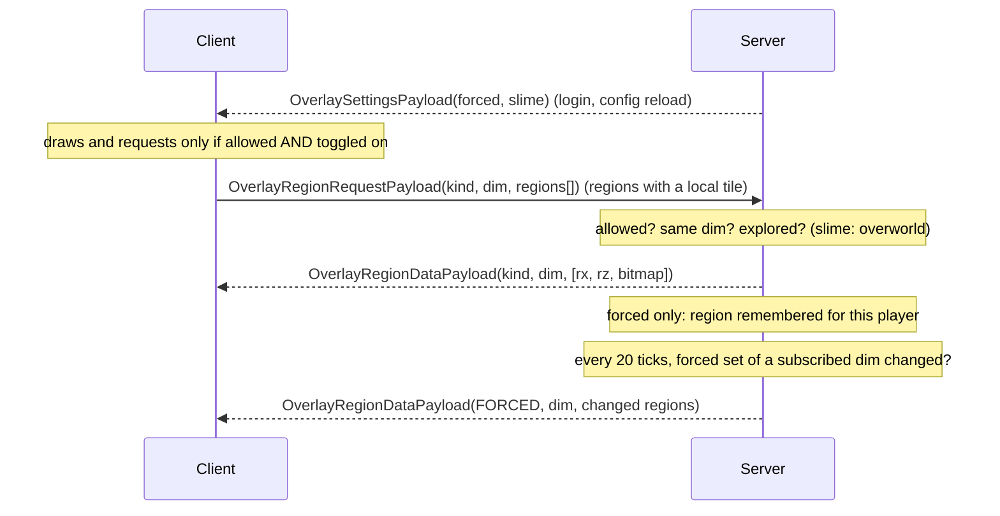

# 13 — Chunk overlays (force-loaded and slime chunks)

Two optional map overlays whose data only the server knows: the **force-loaded chunks** and
the **slime chunks** (overworld). The server computes them and ships compact per-region chunk
bitmaps; the client draws them on the minimap and the fullscreen map. Both are built the way
a third-party addon would build them — on the public client API only (`MapRenderEvent`,
`FullMapToolbarEvent`, `FullMapInfoBarEvent.Hover`, see [09 §8](09-public-api.md)) — so they
double as reference implementations.

Implementation: `ChunkOverlayService` (server), `ChunkOverlayPayloads` (`common.network`),
`ChunkOverlayKind` (`common.overlay`), `OverlaysServerConfig` (`common.config`),
`ChunkOverlayStore`, `ChunkOverlayRenderer`, `ForcedChunksOverlay`, `SlimeChunksOverlay`
(`client.overlay`).

| Overlay | Wire id | Data source | Dimensions | Default colour |
|---------|---------|-------------|------------|----------------|
| Force-loaded chunks | `forced_chunks` | `ServerLevel.getForcedChunks()` (vanilla `/forceload`) ∪ NeoForge block and entity chunk tickets (`ForcedChunksSavedData`, ticking and non-ticking) | Every dimension | Translucent orange `0x60FF9A1F` |
| Slime chunks | `slime_chunks` | Vanilla test `WorldgenRandom.seedSlimeChunk(cx, cz, levelSeed, 987234911).nextInt(10) == 0`, evaluated on the server | Overworld only | Translucent green `0x5040E060` |

## 1. Data format

| ID | Requirement |
|----|-------------|
| OVL-01 | The unit of transfer is one map region (32 × 32 chunks, same grid as [01](01-regions-layers-storage.md)). Its chunk bitmap is **16 longs** (1 024 bits); bit `localZ × 32 + localX` (floor-mod of the chunk coordinates) is set when the chunk is flagged. This is the layout of the regen masks and of the client content masks. |
| OVL-02 | On the wire a bitmap has either **0 words** ("no chunk flagged", 1 byte) or exactly **16 words**; any other length is a decoding error. Region coordinates are VarInts. |
| OVL-03 | Kind ids travel as strings (≤ 32 chars). A receiver that does not know an id decodes `null` and ignores the payload. |

## 2. Protocol

| Payload | Dir | Content |
|---------|-----|---------|
| `OverlaySettingsPayload(forcedChunks, slimeChunks)` | S2C | The overlays the server allows. Sent at login and on every server config reload |
| `OverlayRegionRequestPayload(kind, dimension, rxs[], rzs[])` | C2S | Regions of the player's current dimension whose bitmap the client wants |
| `OverlayRegionDataPayload(kind, dimension, [(rx, rz, bits)])` | S2C | Answer to a request, or push of the changed forced-chunk regions |

The three payloads are registered through `ChunkOverlayPayloads` and dispatched through the
`Payloads.Hooks` indirection (`clientOverlaySettings`, `clientOverlayRegionData`,
`serverOverlayRegionRequest`), like every other group ([03 §7](03-sync-protocol.md)).

## 3. Server

| ID | Requirement |
|----|-------------|
| OVL-04 | The server flags `overlays.forcedChunksEnabled` / `overlays.slimeChunksEnabled` ([08](08-configuration.md)) are announced to every player at login and re-broadcast on a server config reload. A **disabled overlay is never answered and never pushed**, whatever clients send. Disabling forced chunks drops the change snapshots and all remembered regions. |
| OVL-05 | A request is dropped when the kind is unknown or disabled, when its dimension differs from the player's current one, when the kind is `slime_chunks` outside the overworld, or when the player's previous accepted request **of the same kind** is less than **200 ms** old. At most **64** regions are processed per request (the decoder rejects more than 256). |
| OVL-06 | **Explored gate.** A region is answered only if it is already part of the map the player can receive: `versionOf(key, trusted) ≥ 0` for its INFO sidecar, or for any active layer of the dimension (every configured cave band for `cave`), with the same quarantine trust as the region sync ([04 §4](04-privacy-and-anti-exploit.md)). Other regions get no answer. The granularity is the region: one mapped chunk makes its 1 024 neighbours' bits available. |
| OVL-07 | **Slime chunks.** Computed on the server main thread with the level seed, one bitmap per region (1 024 vanilla tests). The seed is never sent. Results (including "none") are cached in an access-ordered LRU of **2 048** regions and cleared when the server stops. |
| OVL-08 | **Forced chunks.** The set of a dimension is the union of vanilla forced chunks and NeoForge block/entity tickets. It is snapshotted (set + bitmap per region) on the first request for that dimension and answered from the snapshot. |
| OVL-09 | **Change push.** Every region answered for `forced_chunks` is remembered for the requesting player (**≤ 1 024**, oldest evicted, cleared on dimension change and logout). Every **20 ticks** the server recomputes the forced set of each snapshotted dimension; when it differs, the regions holding a changed chunk are re-sent (empty bitmap when the last chunk of a region is gone) to the players who remembered them and are still in that dimension, in packets of ≤ 64 regions. A dimension nobody remembers any more drops its snapshot. A forced chunk change in a region nobody requested costs nothing. |
| OVL-10 | The server never loads a chunk for these overlays, and never reads chunk data: the forced set is saved data, the slime test is arithmetic. |

## 4. Client

| ID | Requirement |
|----|-------------|
| OVL-11 | `ChunkOverlayStore.isAllowed(kind)` is false until the server announces the overlay and false again after logout; nothing is requested, drawn or shown (button, hover) for a disallowed overlay, whatever the client toggle says. Receiving a "disallowed" flag drops the stored data of that overlay. |
| OVL-12 | **Request policy.** A region is requested only when the client already has its INFO sidecar version (`ClientMapCache.versionOf ≥ 0`), i.e. unexplored areas cost nothing. At most one request per region every **5 s**; at most one packet per overlay every **300 ms**, with ≤ 64 regions of the current dimension (the rest stays queued). Slime bitmaps are asked once per session and region; forced bitmaps are refreshed every **60 s** while displayed (safety net: the server pushes changes). |
| OVL-13 | Received bitmaps are kept in an access-ordered LRU of **4 096** regions; the store is cleared at login and fully reset (including the allowed flags) at logout. |
| OVL-14 | **Drawing** (`ChunkOverlayRenderer`, from a `MapRenderEvent` listener, so above the tiles and below waypoints and player markers, [07 §2.4](07-client-ui.md)): for every region intersecting the view (rotating-minimap overshoot of √2 included) the flagged chunks of a row are merged into one filled rectangle. The pose is anchored near the view centre (1 unit = 1 block) to keep float precision at large coordinates. Overlays are shown on **every layer**. |
| OVL-15 | Slime chunks are neither drawn nor requested below **0.25 GUI px per block** (a chunk under 4 px wide). Both overlays skip a frame whose view covers more than **2 500** regions. |
| OVL-16 | **Toggle.** One button per overlay, contributed through `FullMapToolbarEvent` to the `TOP_LEFT` **addon zone** (never mixed with the mod's own bars): lodestone icon for forced chunks, slime ball for slime chunks (slime: only when the displayed dimension is the overworld). The button exists only if the server allows the overlay; pressing it flips `map.showForcedChunks` / `map.showSlimeChunks` and saves the client config. The minimap has no toolbar: its only switch is the settings screen. |
| OVL-17 | **Hover.** When the hovered chunk is flagged, the fullscreen bottom bar gets a segment "Force-loaded chunk" / "Slime chunk" through `FullMapInfoBarEvent.Hover`. Looked up in the data already received; never triggers a request. |
| OVL-18 | **Settings.** The Map tab of the settings screen ends with a "Chunk overlays" section holding one toggle per overlay; when the server does not allow an overlay, its row is replaced by the notice "<overlay>: disabled by the server". |

## 5. Privacy

- The world seed never leaves the server. Only the outcome of the slime test is sent, for
  explored regions.
- The slime pattern of a large explored area still carries information about the seed
  (every chunk answers a 1-in-10 test of a seeded generator): a determined client with enough
  explored area could, in principle, search the seed space. This residual leak is inherent to
  showing slime chunks from server data; the mitigation is the explored gate (OVL-06), the
  request throttle (OVL-05), and the server switch `overlays.slimeChunksEnabled` for servers
  that consider it unacceptable ([11](11-limitations-and-open-issues.md), B-18).
- Force-loaded chunk positions can reveal chunk loaders (bases, farms). They are only sent
  for explored regions and can be disabled with `overlays.forcedChunksEnabled`.
- No new vector for hidden players: the data does not depend on where players are.

## Acceptance checks

1. Fresh config, join a server: both overlay buttons exist in the addon zone of the fullscreen
   map (overworld), both toggles are off, nothing is drawn; settings, Map tab, show both rows.
2. Turn on slime chunks over explored terrain at zoom ≥ 0.25: green chunks appear within
   about a second; panning to a new explored region fills it in; over unexplored (grey) areas
   nothing appears and no request is sent.
3. Hover a green chunk: the bottom bar shows "Slime chunk". In the Nether the slime button is
   absent and nothing is drawn.
4. `/forceload add 0 0 160 160` (or a chunk loader mod ticket): with forced chunks on, the
   area turns orange within about a second without reopening the map; `/forceload remove
   all` clears it within about a second.
5. Set `overlays.slimeChunksEnabled=false` in the world's server config and reload: the slime
   button disappears from open maps at the next rebuild (resize or reopen), drawn chunks
   vanish, and the settings row reads "disabled by the server". Re-enable: the row and button
   return.
6. Disable both: a modified client that still sends requests gets no answer (check server
   side that no `OverlayRegionDataPayload` is sent).
7. Toggle, close the game, reopen: the toggles keep their state (`sharedjourney-client.toml`
   `[map]`).
8. Two clients on one server, both with forced chunks on: a `/forceload` change appears on
   both maps within about a second, provided each one displays (or has displayed) the
   region.
