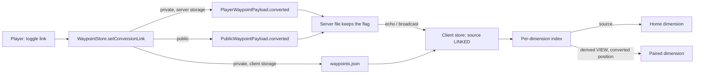

# 14 — Converted waypoints (Overworld / Nether)

A player can **link** one of their waypoints so that a read-only counterpart, with converted
coordinates, is also shown in the paired dimension (Overworld to Nether and back). The link
is always an explicit player action; nothing creates it automatically.

## 1. Design

### 1.1 Audit of the cross-dimension behavior before this feature

| Aspect | State before |
|--------|--------------|
| Storage | Every waypoint is bound to one home dimension (`Waypoint.dimension`). The former cross-dimension `GLOBAL` type was migrated to `DIMENSION` ([06 WS-03](06-waypoints.md)); nothing displayed a waypoint outside its dimension. |
| Filtering | `WaypointStore.forDimension` is the single read path of the minimap, the fullscreen map and the in-world beacons (the manager lists `all()`); each then filters on `isShown`. The index is rebuilt lazily after every mutation ([06 WS-08](06-waypoints.md)). |
| Server | Private (`waypoints/<uuid>.json`) and public (`waypoints_public.json`) files store the shared fields as the payload records carry them; they know nothing about display. |
| JourneyMap bridge | One-way inward: bridged mods' waypoints enter the store; the bridge's `getAllWaypoints` returns only the objects the bridged mods created ([10 JM-10, JM-13](10-compat-bridges.md)). Shared Journey waypoints are never exposed to JourneyMap, so nothing there can see a derived counterpart. |
| Public API | `WaypointApi.forDimension(dim)` and `all()` return stored waypoints only. |

### 1.2 Derived view, not a second waypoint

The link is a flag (`Waypoint.Conversion.LINKED`) on the **source** waypoint. The counterpart
is a **derived view** (`Conversion.VIEW`) that the client builds on the fly when it builds its
per-dimension index; it is never stored, sent or persisted.

| Option | Verdict |
|--------|---------|
| Separate linked waypoint (a second stored entry in the other dimension) | Rejected: two records to keep in sync (move, rename, recolour, delete, group, public/private transitions), orphans after partial failures or offline edits, double the server storage and caps, and a stored copy would need its own read-only rules. |
| Derived view from a flag on the source (chosen) | No duplicated data: moving, renaming, recolouring, regrouping or deleting the source is instantly reflected, there is nothing to desynchronize, unlinking is a single flag change, and a feature switch can hide every counterpart without touching storage. |

### 1.3 Conversion rules (`common.waypoint.DimensionConversion`)

Only the vanilla Overworld and Nether form a pair; every other dimension has no counterpart.

| Direction | X / Z | Y |
|-----------|-------|---|
| Overworld to Nether | `floorDiv(value, 8)` | kept, then clamped to the Nether's buildable range `0..127` |
| Nether to Overworld | `value * 8` | kept, then clamped to the Overworld's range `-64..319` (always inside it for a Nether source) |

The Y choice keeps a surface marker at its height (a base at Y 64 stays at 64) and pulls an
out-of-range height to the nearest valid block, like vanilla portal linking. The position is
plain arithmetic: it is not snapped to an existing portal.

### 1.4 What can be linked

A hand-made waypoint (`source = user` or `public`) of type `DIMENSION` or `PUBLIC`, in the
Overworld or the Nether, including death waypoints. Not linkable: `TEMP` (removed on arrival),
banner and automatic waypoints (world-derived, owned by the server; portals already exist at
both ends), bridged waypoints, and any waypoint of another dimension.

### 1.5 Ownership

The flag is stored with its waypoint, so it follows that waypoint's existing rules:

- **Private** waypoint: stored in the owner's file (server storage) or the client file (client
  storage); only the owner sees the counterpart.
- **Public** waypoint: the flag is a shared field, persisted in `waypoints_public.json` and
  visible to everyone. As for every other public field there is no ownership check: any player
  may link or unlink it ([06 PUB-05](06-waypoints.md), [11 L-05](11-limitations-and-open-issues.md)).

## 2. Requirements

| ID | Requirement |
|----|-------------|
| CONV-01 | `Waypoint` carries a `conversion` state: `NONE` (default), `LINKED` (source whose counterpart is shown) or `VIEW` (derived counterpart). The 11-argument constructor is kept (state `NONE`) so existing API consumers still compile. |
| CONV-02 | The counterpart is derived client-side in `WaypointStore.forDimension`: same id, group, colour, source, type and visibility flag as its source; converted position ([§1.3](#13-conversion-rules-commonwaypointdimensionconversion)); name `"<name> (converted)"` (`sharedjourney.waypoint.converted.name`, resolved when the index is built). It exists only while the server switch is on and the source is linkable. |
| CONV-03 | The counterpart is read-only: `add` and `update` ignore a `VIEW`; the map double-click does not open the edit form on it; the manager never lists it (`all()` excludes views); no `WaypointEvent` is posted for it. `remove(id)` acts on the source. |
| CONV-04 | Visibility is the source's: hiding the source (list toggle, group visibility, "Hide all" in either dimension) hides its counterpart. `setAllVisible(dim, v)` applies to the source when the entry shown is a counterpart. |
| CONV-05 | Every surface draws the counterpart through the usual paths (minimap, fullscreen map with name label and hover tooltip, in-world beacon with beam, icon and label) and with the dedicated hollow-diamond sprite `textures/gui/waypoint/converted.png`, tinted by the colour ([06 BCN-03](06-waypoints.md)). |
| CONV-06 | The link is set only by an explicit player action: the manager row button (arrows), the edit/create form row "Converted: On/Off", or the fullscreen map context-menu row "Show / Hide converted waypoint" (right click on a waypoint or on its counterpart; on a counterpart it unlinks the source). All go through `WaypointStore.setConversionLink` / `update`. Nothing sets it automatically. |
| CONV-07 | The edit form offers the toggle only while the server switch is on and the waypoint is linkable. Choosing the `TEMP` type disables it and the saved waypoint is not linked. When the toggle is not offered (switch off) an edit keeps the stored (dormant) flag. |
| CONV-08 | Wire: a `boolean converted` is appended to `PublicWaypointPayload` and `PlayerWaypointPayload` (both directions); `LayerSettingsPayload` gains `convertedWaypointsEnabled`; `OpsConfigPayload` gains `convertedWaypointsEnabled`. No new payload type ([03](03-sync-protocol.md)). |
| CONV-09 | Persistence: server private file entries and `waypoints_public.json` entries carry `"converted": true` only when linked (absent = false, old files load unchanged); the client `waypoints.json` entry carries it for locally stored waypoints. |
| CONV-10 | Server switch `waypoints.convertedWaypointsEnabled` (default **true**; ops tab row "Converted waypoints", config and NeoForge config screen, [08](08-configuration.md)), announced to clients in `LayerSettingsPayload` (login, reload, ops apply). Off: no counterpart is built or drawn, the link toggles are hidden, `setConversionLink(.., true)` is refused. |
| CONV-11 | Dormancy: while the switch is off, the server upsert keeps the **stored** flag whatever the client sends (`DimensionConversion.resolveLink`), for private and public waypoints alike; existing links stay on disk and the counterparts return when the switch is turned on again. While it is on, the requested flag is stored (only for a paired dimension). |
| CONV-12 | Client store normalization (`normalizedConversion`): a waypoint that cannot be linked (TEMP, world-derived, bridged, unpaired dimension) loses the flag; while the switch is off the stored flag is preserved instead of following the incoming value. |
| CONV-13 | A change of the link flag on a PUBLIC or server-managed waypoint counts as a shared-field change, so it is pushed to the server like a move or a rename; type transitions (private to public and back) carry the flag along. |
| CONV-14 | `WaypointApi.forDimension` includes counterparts (`Waypoint.isConvertedView()`); `all()` does not; `add` / `update` ignore them. The JourneyMap bridge neither receives nor exposes counterparts ([§1.1](#11-audit-of-the-cross-dimension-behavior-before-this-feature)). |
| CONV-15 | The manager shows, for a linked waypoint while the switch is on, "· ⇄ converted in <dimension>" on its info line; its button is green when linked, gray otherwise. |

## 3. Limits

See [11 B-21](11-limitations-and-open-issues.md).

## Acceptance checks

1. In the Overworld, create a waypoint at X 800 Z -400 (Y 70). In its edit form set
   "Converted: On" and save. Go to the Nether: a hollow-diamond marker "name (converted)" is
   on the minimap, the map and as a beacon at X 100 Z -50, Y 70. Back in the Overworld it is
   the normal waypoint only.
2. Link a Nether waypoint at X 100 Z 100 Y 40: in the Overworld its counterpart is at
   X 800 Z 800 Y 40. Link an Overworld waypoint at Y 200: its Nether counterpart is at Y 127.
3. Move, rename, recolour or delete the source: the counterpart follows at once. Unlink it
   from the manager button or from the map context menu (also when right-clicking the
   counterpart itself): the counterpart disappears.
4. Double-click the counterpart on the map: nothing opens. It is absent from the manager list.
5. Hide the source (manager toggle or its group): the counterpart is hidden too.
6. Make a public waypoint and link it: every player sees the counterpart in the paired
   dimension; unlink as another player: it disappears for everyone.
7. Create a TEMP waypoint: no toggle in the form; switch an existing linked waypoint to TEMP
   and save: it is no longer linked.
8. An end-dimension waypoint, a banner, a bed/portal/anchor marker: no toggle anywhere.
9. Set `convertedWaypointsEnabled = false` (ops tab): every counterpart vanishes, the toggles
   disappear. Edit a linked waypoint meanwhile (rename it). Set it back to true: the links are
   still there and the counterparts return.
10. Reconnect (and, with `waypointStorage = CLIENT`, restart the client): links persist.
